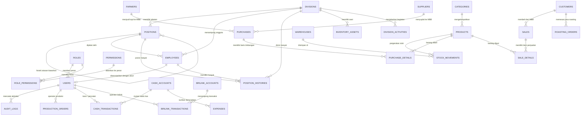

# ENTITY RELATIONSHIP DIAGRAM (ERD)
## MBB BUSINESS MANAGEMENT SYSTEM (mbb_management)
### CV. MAJU BERKAH BERSAMA

---

### 1. DIAGRAM MERMAID ENTITAS & RELASI

---

### 2. KARDINALITAS & LOGIKA RELASI PENTING

1. **User vs Employee (1 : 0..1)**:
   - Satu pegawai *bisa* memiliki akun sistem, tetapi *tidak wajib*.
   - Satu akun sistem terikat pada satu pegawai yang diverifikasi.
   - Hak akses login sistem (`role_id`) tidak sama dengan jabatan struktural (`position_id`).

2. **Position Parent-Child (Hierarki Organisasi)**:
   - `positions.parent_position_id` merujuk kembali ke `positions.id`.
   - Pola ini memungkinkan pembentukan pohon hierarki dinamis (Komisaris -> Direksi -> Direktur -> Manager -> Divisi).

3. **Stock & Accounting Integrity**:
   - Pembelian (`purchases`) dan Penjualan (`sales`) menggerakkan tabel `stock_movements` dan `cash_transactions` secara atomik di dalam satu `DB::beginTransaction()`.
   - Modul BRILink mencatat biaya admin dan fee jasa ke `cash_transactions` dengan referensi `source_type = 'BRILINK'`.

4. **Multi-Divisi Activity Tracking**:
   - Proyek dekorasi atau penyewaan sound sistem dapat mencatat biaya pengeluaran dan pemasukan langsung terhubung ke kas perusahaan.
